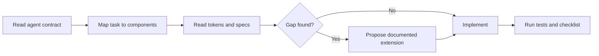

# Using Aether UI with Claude and Codex

This guide makes Aether UI a dependable context source for coding agents. The goal is
not to ask an agent to imitate a visual style; it is to make the agent follow the same
tokens, contracts, states, and quality checks as a human contributor.

## Repository entry points

- **Codex and general agents:** `AGENTS.md`
- **Claude:** `CLAUDE.md`, which delegates to `AGENTS.md`
- **System intent:** `ai/design-system.md`
- **Required workflow:** `ai/generation-rules.md`
- **Quality gate:** `ai/review-checklist.md`
- **Reusable tasks:** `ai/prompts/`

Keep these files in the repository root and do not paste a reduced duplicate into every
task. Agents should read the current files so system changes propagate automatically.

## Minimum context for a task

A useful request gives the agent:

1. the user outcome or job to be done;
2. the target platform or framework;
3. the screen, flow, or component boundary;
4. real constraints such as supported viewports, data states, or browser versions;
5. the expected verification.

The design system already supplies visual direction, component behavior, accessibility,
themes, glass-material rules, and decision priority. Repeating those rules in a prompt
is unnecessary.

## Recommended agent workflow



## Example: Codex

```text
Implement the project-creation form in Angular using Aether UI.
Use the existing TextField, Select, Checkbox, Toggle, Button, Card, and Dialog contracts.
Include validation, submitting, success, and API error states. Add component tests and
report any missing Aether UI behavior before extending the system.
```

## Example: Claude

```text
Create a responsive account settings screen in React. Follow CLAUDE.md and the Aether UI
contracts. Use realistic French content. Show which tokens and contracts you applied,
then review the result with ai/review-checklist.md.
```

## Expected completion report

An agent should finish with a compact report such as:

```text
Contracts: TextField, Select, Checkbox, Toggle, Button, Card
Tokens: semantic colors, glass surface/strong/border/highlight, glass blur medium,
spacing 8/16/24, radius 10/16, normal motion
States: default, focus, validation error, disabled, loading, API error, success
Verification: unit tests, keyboard path, light/dark, 375/768/1440 px, reduced motion,
reduced transparency, backdrop-filter fallback, contrast over background extremes
Gaps: no missing design-system behavior
```

## Handling a missing component

The agent must not create a local visual component and call it Aether UI. It should:

1. explain why existing components do not satisfy the need;
2. propose a framework-neutral name, purpose, API, states, and accessibility behavior;
3. identify required tokens;
4. update the specification and visual documentation;
5. implement the platform adapter only after the contract is accepted.

## Keeping agent context healthy

- Prefer links to authoritative files over copied instructions.
- Keep component contracts small, explicit, and testable.
- Update visual docs and agent docs in the same change when system behavior changes.
- Do not describe placeholders in `packages/` as finished adapters.
- Run `python3 scripts/build_css.py` and the test suite after token changes.
